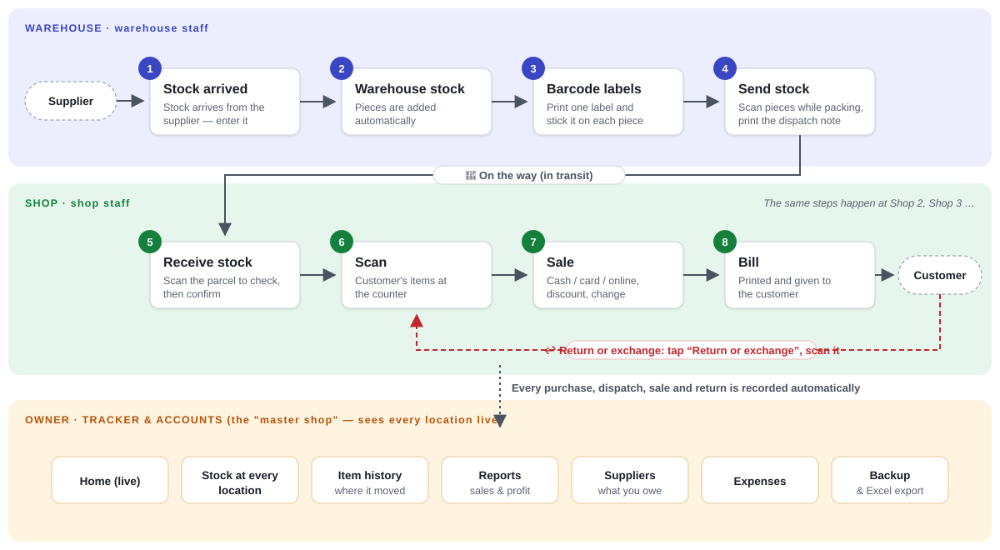

# Velanzo — shop & warehouse software

Simple software for a clothing business: **stock arrives → barcode labels → send to a shop → scan → sale → bill**, with stock at every place and accounts for the owner.

- It's a **website** that installs like an app (Chrome / Edge "Install", or "Add to Home screen" on a phone). Nothing to set up on the computers.
- **Works without internet.** Every computer keeps its own copy; changes wait there and go to the cloud when the internet is back.
- The data lives in **Supabase** (a cloud database). No computer has to stay on.
- The **owner** sees every shop and the warehouse live, on a laptop or a phone.
- The owner decides **what each shop may do** (sell, returns, discounts, buy from suppliers, send stock …) and can switch things off for one person. The owner makes a user ID and password for each person (**Settings → Users**). The person signs in once on their own computer and chooses their own 4-digit passcode. The computer stays signed in, but asks the passcode on every open, like a phone; a forgotten passcode is approved by the owner with a link sent to the owner's email.



**Training:** in the app, **More → Training** has guided practice (arrow and text, step by step) for the daily jobs, on DEMO data that is removed afterwards.

**User guide, with a picture of every screen:** in the app click your name → **How to use**, or open [docs/Velanzo-User-Guide.pdf](docs/Velanzo-User-Guide.pdf) to print it or send it to staff.

## Getting it running

| What | How |
|---|---|
| **Connect your own GitHub + Supabase** (to use it for real, on many computers) | Follow [docs/SETUP-CLOUD.md](docs/SETUP-CLOUD.md) — about 20 minutes, once. |
| **Try it on this computer** (with a stand-in for the cloud) | `npm install`, then `npm run dev`, open <http://localhost:4000>. For a filled-in demo business: `node tools/demo-data.mjs` (logins go to `.dev-cloud/demo.json`). A second "device": open <http://127.0.0.1:4000>. |
| **One computer, no cloud** | Publish the `web/` folder anywhere (or GitHub Pages) with `web/config.js` left empty. Everything stays on that one device; it can join the cloud later and bring its data. |

## How it's built

- `web/` — the whole website (published as is, no build step).
  - `engine/` — all the shop logic (bills, stock, purchases, dispatch, reports, backups). It runs in a background worker in the browser on **SQLite saved on the device**, and the same code runs in Node for the tests.
  - `js/` — the screens. `js/cloud.js` signs in to Supabase and keeps the device in sync (`engine/syncer.js`).
  - `sw.js` + `manifest.webmanifest` — makes it installable and lets it open without internet.
  - `config.js` — the Supabase address and public key (empty = one device, no cloud).
  - `manual/` — the user guide.
- `supabase/migrations/` — the cloud database: tables, and the functions `push` / `pull` that check every change against the shop's and person's switches (devices can't touch the tables directly).
- `tools/` — local preview (`dev-server.mjs`, with a stand-in for Supabase on PGlite), demo data, screenshots for the guide, tests.
- `.github/workflows/pages.yml` — runs the tests and publishes `web/` to GitHub Pages on every change to `main`.

How syncing works, in short: every record id is unique across devices (device number × 1,000,000,000 + a counter), each action is saved on the device and noted in an outbox, `push` sends whole actions (refused ones are shown to the owner), `pull` brings back what changed since last time. Stock in the cloud is always the sum of its history, so two places changing stock at the same time never overwrite each other. Bills, purchases and parcels carry the device's letter (`S1-C0042`), so numbers never clash. More detail: [docs/PLAN-supabase-offline.md](docs/PLAN-supabase-offline.md).

## Tests

```bash
npm test
```

Runs the shop flows on one device (59 checks), three devices syncing through the cloud database, including the owner lock, owner-only rules, user ID sign-in, passcode approval and drafts with reset to draft (174 checks), practice mode putting everything back exactly (19 checks), clearing data by kind and date (18 checks), and the "Please check this" warnings with every report (24 checks). With the preview running and demo data loaded, `node tools/test-browser.mjs` checks a real browser selling without internet, reopening offline and syncing afterwards, `node tools/test-training.mjs` follows every Training guide in a real browser, `node tools/test-scanner-print-browser.mjs` types like a USB scanner into every kind of box, checks the Hardware and Print queue pages and the per-computer printer settings, and reads the printed barcodes back at 203 and 300 dpi, `node tools/test-drafts-browser.mjs` saves, edits, confirms and resets drafts and holds bills, `node tools/test-users-browser.mjs` adds a user, signs in, chooses a passcode, locks, switches account and removes a computer, `node tools/test-recovery-browser.mjs` forgets passcodes and a password and recovers with the emailed links, `node tools/test-clear-browser.mjs` clears data by date and then everything with a shop computer following (this one empties the preview's demo data; refill it with `node tools/demo-data.mjs`), and `node tools/test-local-to-cloud.mjs` checks a computer that started without the cloud joining it with its data (this one empties the preview's cloud).

## Backups and moving data

- **Settings → Backup & data → Download full backup**: one `.json` file with everything (same format as every earlier version: `app`, `schema_version`, `tables`). The owner's home screen reminds you weekly.
- **Restore** replaces everything — on every device — with a backup file. Backups from the old single-computer version load too (people then get new PINs from the owner).
- **Manage data** (same screen): see what is stored, clear bills/purchases/parcels/expenses/stock history for chosen dates, or clear everything to start fresh. A backup file is downloaded first and every computer is cleared.
- **Excel**: items, stock, bills, bill lines, purchases, dispatches, expenses, suppliers and the full stock history, for any dates; plus importing many items from a spreadsheet.

## Updating the software

Change the files, run `npm test`, push to `main`. GitHub publishes the new version, and each device takes it the next time it opens with internet. If a change needs a new cloud database rule, add a new file in `supabase/migrations/` and run it once in Supabase (SQL Editor) — never edit an old one after it has been run.
